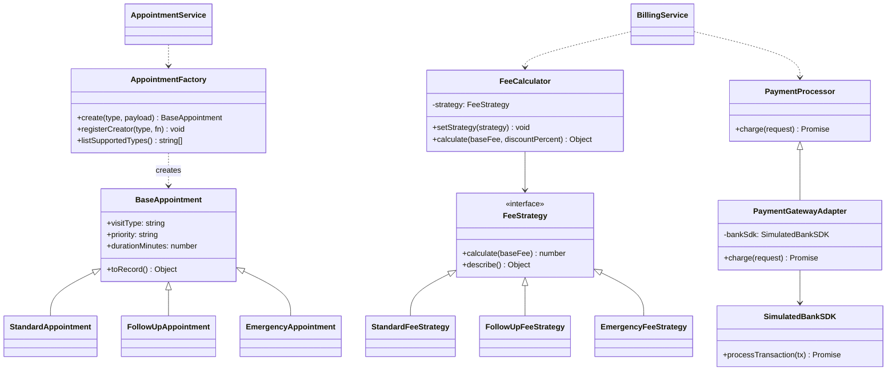

# MedSlot — CSE 3206 Software Engineering Sessional Project Report

**Course:** CSE 3206 – Software Engineering Sessional (22 Series)  
**Department:** Computer Science & Engineering, Rajshahi University of Engineering & Technology (RUET)  
**Project Title:** MedSlot — Clinic Appointment & Billing Manager  
**Domain:** Outpatient Clinic Scheduling, Physician Directory, and Automated Billing

---

## 1. System Overview & Five Functional Modules

MedSlot is an end-to-end web application built with Node.js (ESM), Express 5, built-in SQLite (`node:sqlite`), React 19, and Tailwind CSS v4. Data persists locally in `data/medslot.db` across five normalized relational tables (`users`, `patients`, `doctors`, `appointments`, `invoices`).

1. **Auth Module (`authService.js`, `/api/auth`)**: Registers staff accounts, hashes passwords with `crypto.scryptSync` + 16-byte random salt, authenticates logins, and issues HMAC-SHA256 Bearer tokens (`authMiddleware.js`). Seeds `admin@medslot.local` / `admin123` on first startup.
2. **Patients Module (`patientService.js`, `/api/patients`)**: Full CRUD management of patient records (`fullName`, `phone`, `email`, `age`, `gender`, `bloodGroup`) with live name/phone search.
3. **Doctors Module (`doctorService.js`, `/api/doctors`)**: Manages clinic physicians, specialties, consultation base fees, specialty filtering, and shift availability toggles.
4. **Appointments Module (`appointmentService.js`, `/api/appointments`)**: Books `STANDARD`, `FOLLOW_UP`, and `EMERGENCY` visits using `AppointmentFactory`, rejects unavailable doctors, detects double-booking slot collisions (`doctorId + appointmentDate + timeSlot` for non-cancelled visits), supports `SCHEDULED` → `COMPLETED` | `CANCELLED` transitions, and dispatches appointment notices through an injectable `notificationService`.
5. **Billing Module (`billingService.js`, `/api/billing`)**: Computes consultation invoices via `FeeStrategy` and `FeeCalculator` (enforcing a 30% maximum discount cap), prevents duplicate invoices for the same appointment, processes payments via `PaymentGatewayAdapter`, and aggregates live clinic KPIs (`/api/billing/summary`).

---

## 2. Requirements & Process Model

### 2.1 Functional Requirements
- **FR-1**: Clinic staff shall register new accounts and sign in with email and password to receive an authenticated Bearer session.
- **FR-2**: Unauthenticated requests to patient, doctor, appointment, or billing endpoints shall return HTTP `401`.
- **FR-3**: Staff shall create, list, search (by name or phone), edit, and delete patient profiles with age validation (`0–130`).
- **FR-4**: Staff shall add doctors with specialty and non-negative consultation fees and filter doctors by specialty.
- **FR-5**: Staff shall toggle a doctor's availability status; unavailable doctors cannot receive new bookings.
- **FR-6**: Staff shall book `STANDARD`, `FOLLOW_UP`, or `EMERGENCY` appointments with automatic priority (`NORMAL`, `LOW`, `URGENT`) and slot duration (`20m`, `15m`, `30m`) assignment.
- **FR-7**: The system shall prevent double-booking the same doctor on the same `appointmentDate` and `timeSlot` unless the prior visit was `CANCELLED` (returning HTTP `409`).
- **FR-8**: Staff shall transition scheduled appointments to `COMPLETED` or `CANCELLED`; cancelled visits cannot be reopened.
- **FR-9**: The system shall generate at most one invoice per non-cancelled appointment, computing final BDT fees via the matching visit-type strategy and optional discount (`0–30%`).
- **FR-10**: Staff shall settle `UNPAID` invoices via `CARD`, `BKASH`, or `CASH` through the bank payment adapter and persist the gateway transaction reference.
- **FR-11**: The Dashboard shall display live counts of total patients, available doctors, scheduled visits, collected revenue, and unpaid invoices.
- **FR-12**: The backend shall expose interactive Swagger UI documentation at `/api-docs` and raw OpenAPI JSON at `/api-docs.json`.

### 2.2 Non-Functional Requirements
- **NFR-1 (Persistence & Integrity)**: Relational data shall persist across server restarts in SQLite with `PRAGMA foreign_keys = ON`.
- **NFR-2 (Security)**: Passwords shall never be stored or returned in plaintext (`scrypt` salted hashes + constant-time verification).
- **NFR-3 (Maintainability & Extensibility)**: Core creation, fee calculation, and gateway integration shall use decoupled GoF patterns so new visit types or payment SDKs can be added without modifying service logic.
- **NFR-4 (Testability)**: Business services shall accept injected repositories and external collaborators so unit tests run deterministically in milliseconds with mocks.
- **NFR-5 (Usability)**: The UI shall provide responsive tables, modal forms, clear error banners, and a single-command build served alongside the API on port `4000`.
- **NFR-6 (Automation)**: Unit coverage tests and headless Chrome Selenium E2E flows shall execute automatically on every push/PR in GitHub Actions.

### 2.3 User Stories & Use Case Summary

| ID | User Story | Acceptance Criteria |
|---|---|---|
| **US-1** | As a clinic receptionist, I want to register and search patients quickly so check-in takes seconds. | Adding a patient persists to SQLite; typing in search filters by name or phone immediately. |
| **US-2** | As a clinic coordinator, I want the scheduler to block overlapping slots and unavailable doctors so physicians never face double-bookings. | Booking an occupied slot returns HTTP `409` with conflict message; toggling doctor availability blocks new slots. |
| **US-3** | As a billing clerk, I want emergency and follow-up visits to apply clinic pricing rules automatically and record bank transaction IDs. | Invoice displays calculated strategy total (e.g., `1.5× + 200` for Emergency) and updates to `PAID` with `BANK-INV-...` reference after checkout. |

**Primary Use Cases:**
- **UC-1 Authenticate Staff** (`LoginPage` → `POST /api/auth/login`)
- **UC-2 Register & Manage Patient** (`PatientsPage` → `POST/PUT/DELETE /api/patients`)
- **UC-3 Schedule Triage Appointment** (`AppointmentsPage` → `POST /api/appointments` → `AppointmentFactory` + `notificationService`)
- **UC-4 Generate & Settle Invoice** (`BillingPage` → `POST /api/billing/invoices` → `FeeStrategy` → `POST .../pay` → `PaymentGatewayAdapter`)

### 2.4 Prototype / Low-Fidelity Mock-up
Before building the React + Tailwind UI, four low-fidelity screen wireframes (Login, Dashboard, Appointment Modal, and Billing Table) were drafted in [`docs/diagrams/wireframe-mockup.svg`](diagrams/wireframe-mockup.svg).

### 2.5 Chosen Process Model & Justification
**Chosen Model:** **Iterative & Incremental Development (Lightweight Agile)**  
**Justification:** Because MedSlot comprises five distinct vertical modules plus cross-cutting patterns and self-directed API documentation, building and verifying one vertical slice per feature branch (`feature/core-patterns` → `feature/backend-modules` → `feature/swagger-openapi` → `feature/frontend-ui` → `feature/selenium-ci`) minimized integration risk compared to Waterfall while remaining realistic for a single developer without heavy Scrum ceremony.

---

## 3. Design Patterns & UML Class Diagram

### 3.1 UML Class Diagram
Full visual diagram: [`docs/diagrams/uml-class-diagram.svg`](diagrams/uml-class-diagram.svg)



### 3.2 Pattern Justifications & Rejected Alternatives

1. **Creational — Factory Method (`src/patterns/AppointmentFactory.js`)**
   - **Problem Solved:** Booking logic needs to construct appointments with visit-specific `priority` and `durationMinutes` (`STANDARD`: 20m/NORMAL, `FOLLOW_UP`: 15m/LOW, `EMERGENCY`: 30m/URGENT) while staying extensible via `registerCreator()` without editing `AppointmentService`.
   - **Rejected Alternative:** **Abstract Factory.** Abstract Factory creates *families* of related objects (e.g., matching UI widgets or regional tax/receipt suites). MedSlot creates a single product hierarchy (`BaseAppointment`), so Abstract Factory would add unnecessary interface boilerplate.

2. **Behavioral — Strategy (`src/patterns/FeeStrategy.js`)**
   - **Problem Solved:** Consultation fees follow distinct pricing formulas (`1.0×`, `0.5×`, `1.5× + ৳200`) plus clinic discount caps (`MAX_DISCOUNT_PERCENT = 30`). Strategy isolates each rule inside its own small class orchestrated by `FeeCalculator`.
   - **Rejected Alternative:** **Template Method (or inline `switch` conditionals).** Template Method locks pricing into inheritance hooks and forces a new subclass whenever discount composition changes; inline `switch` statements bloat `BillingService` and violate Open/Closed.

3. **Structural — Adapter (`src/patterns/PaymentGatewayAdapter.js`)**
   - **Problem Solved:** `SimulatedBankSDK.processTransaction({ totalCents, externalRef, channel })` expects integer cents and returns `{ ok, bankTxnId, settledCents, channelUsed }`, which conflicts with MedSlot's internal `charge({ amount, invoiceId, method })` domain contract. `PaymentGatewayAdapter` translates inputs and outputs cleanly.
   - **Rejected Alternative:** **Facade Pattern.** A Facade simplifies a multi-class subsystem under a brand-new convenience API, whereas our goal is conforming a *specific incompatible third-party interface* (`SimulatedBankSDK`) to MedSlot's existing `PaymentProcessor` target contract.

---

## 4. Software Testing & CI Pipeline

### 4.1 Test-Driven Development (TDD)
Core pattern logic followed a Red → Green → Refactor git commit cycle:
1. Commit `0dcf01e`: Wrote failing tests in `AppointmentFactory.test.js`, `FeeStrategy.test.js`, and `PaymentGatewayAdapter.test.js` (`3 failed`).
2. Commit `78329cb`: Implemented the three pattern modules until all `15` pattern tests passed.

### 4.2 Mocked External Dependencies (`vi.fn()`)
Every service test isolates external boundaries via dependency injection:
- **Database Repositories** (`userRepo`, `patientRepo`, `doctorRepo`, `appointmentRepo`, `invoiceRepo`): Mocked with `vi.fn()` in `authService.test.js`, `patientService.test.js`, `doctorService.test.js`, `appointmentService.test.js`, and `billingService.test.js` so unit tests do not touch SQLite on disk.
- **Payment Gateway (`SimulatedBankSDK` / `PaymentProcessor`)**: Mocked in `PaymentGatewayAdapter.test.js` and `billingService.test.js` to test both approved settlements and `402` declined transactions deterministically.
- **Notification Service (`notificationService.sendAppointmentNotice`)**: Mocked in `appointmentService.test.js` to verify booking and completion notifications without external I/O.

### 4.3 Observed Test Coverage Summary (`npm run test:coverage`)
All **10 test files (37 unit tests)** pass in `< 500 ms` with V8 coverage:

| Scope / File | % Stmts | % Branch | % Funcs | % Lines |
|---|---:|---:|---:|---:|
| **All Tracked Files** | **90.41** | **77.88** | **93.33** | **90.41** |
| `src/patterns/AppointmentFactory.js` | 93.10 | 80.00 | 90.90 | 93.10 |
| `src/patterns/FeeStrategy.js` | 91.17 | 90.47 | 87.50 | 91.17 |
| `src/patterns/PaymentGatewayAdapter.js` | 88.88 | 76.66 | 75.00 | 88.88 |
| `src/services/appointmentService.js` | 86.48 | 72.72 | 100.00 | 86.48 |
| `src/services/authService.js` | 89.28 | 70.00 | 100.00 | 89.28 |
| `src/services/billingService.js` | 86.66 | 76.19 | 100.00 | 86.66 |
| `src/services/doctorService.js` | 92.85 | 81.25 | 100.00 | 92.85 |
| `src/services/notificationService.js` | 100.00 | 100.00 | 100.00 | 100.00 |
| `src/services/patientService.js` | 95.65 | 82.14 | 100.00 | 95.65 |

### 4.4 Selenium E2E & GitHub Actions CI
- **Selenium E2E (`tests/e2e/clinicFlow.e2e.mjs`)**: Boots an ephemeral Express + temporary SQLite server and drives headless Chrome (`--headless=new`) across five assertions: (1) Staff login & Dashboard KPIs, (2) registering patient *Farhana Akter*, (3) booking an `EMERGENCY` slot with *Dr. Tariq Hasan*, (4) generating a `৳1,400` (`800 × 1.5 + 200`) invoice and settling it to `PAID` (`BANK-INV-...`), and (5) verifying `/api-docs/` renders `"MedSlot Clinic API"`.
- **CI Workflow (`.github/workflows/ci.yml`)**: Runs on every push (`main`, `feature/**`) and pull request (`main`) using Node 24 on `ubuntu-latest`, executing `npm run test:coverage`, `npm run build`, and `npm run test:e2e`, and uploads the `coverage/` artifact.

---

## 5. Configuration Management (Git / GitHub)

- **Branch Naming Convention**: `feature/<module-or-capability>`, `docs/<scope>`, and `pr-demo/<review-scenario>`.
- **Commit Convention**: Conventional Commits (`chore:`, `test(patterns):`, `feat(patterns):`, `feat(backend):`, `feat(docs):`, `feat(ui):`, `feat(billing):`, `feat(qa):`, `docs:`).
- **PR Review Branches**: Two branches (`pr-demo/rejected-fee-hardcode` and `pr-demo/accepted-health-metrics`) are included for demonstrating one rejected/revised PR and one accepted PR during GitHub submission (instructions in `docs/GITHUB_SUBMISSION_GUIDE.md`).

### Real Merge Conflict & Resolution Note
Two parallel billing branches diverged from the same `main` commit and modified overlapping lines in `src/patterns/FeeStrategy.js`:
- `feature/fee-policy-update` (`18246b7`): Added `policyNote: 'Includes urgent triage room allocation'` inside `EmergencyFeeStrategy.describe()` and a validation comment above `FeeCalculator.calculate()`.
- `feature/billing-discount` (`abc3bc7`): Added `priorityBilling: true` inside `EmergencyFeeStrategy.describe()` and introduced `MAX_DISCOUNT_PERCENT = 30` validation inside `FeeCalculator.calculate()` with a corresponding unit test.

Merging `feature/fee-policy-update` succeeded cleanly, after which `git merge --no-ff feature/billing-discount` produced a genuine two-hunk conflict:

```diff
<<<<<<< HEAD
      policyNote: 'Includes urgent triage room allocation',
=======
      priorityBilling: true,
>>>>>>> feature/billing-discount
...
<<<<<<< HEAD
    // Clinic standard discount range validation
    if (typeof discountPercent !== 'number' || !Number.isFinite(discountPercent) || discountPercent < 0 || discountPercent > 100) {
      throw new Error('Discount percentage must be between 0 and 100');
=======
    if (
      typeof discountPercent !== 'number' ||
      !Number.isFinite(discountPercent) ||
      discountPercent < 0 ||
      discountPercent > MAX_DISCOUNT_PERCENT
    ) {
      throw new Error(`Discount percentage must be between 0 and ${MAX_DISCOUNT_PERCENT}`);
>>>>>>> feature/billing-discount
```

**Resolution (`5e24546`):** Combined both `policyNote` and `priorityBilling: true` in `EmergencyFeeStrategy.describe()`, preserved the `MAX_DISCOUNT_PERCENT = 30` ceiling in `FeeCalculator.calculate()`, re-ran `npm test` (33/33 passing at that commit), and committed the merge resolution.

---

## 6. Self-Directed New Tool: Swagger / OpenAPI 3.0

- **Tool Chosen:** Swagger / OpenAPI `3.0.3` (`src/config/openapi.yaml`, `swagger-ui-express`, `yaml`).
- **Comparison with Alternative (Postman Collections):** Postman collections excel for ad-hoc manual API clicks inside a desktop client, but they rely on proprietary JSON exports that live outside standard contract tooling and lack a zero-install live web sandbox served directly from the app. OpenAPI `3.0.3` is an industry-standard declarative YAML contract committed alongside code, rendered interactively at `/api-docs`, downloadable as `/api-docs.json`, and validated automatically by `tests/unit/openapi.test.js` in CI.
- **Concrete Application:** Every endpoint across Auth, Patients, Doctors, Appointments, and Billing—including `bearerAuth` security, query parameters, request schemas, and `401`/`402`/`409` responses—is documented in `src/config/openapi.yaml`, tested in Vitest, linked from the React sidebar (`API Docs (Swagger)`), and verified end-to-end by Selenium.

---

## 7. AI Tool Usage Disclosure

In compliance with course academic integrity guidelines:
- An AI coding assistant (Google Gemini / Antigravity) was used to scaffold project boilerplate, generate React + Tailwind component layouts, draft unit/Selenium test scaffolds, and review Markdown documentation formatting.
- All business logic, GoF pattern implementations (`AppointmentFactory`, `FeeStrategy`, `PaymentGatewayAdapter`), SQLite repository queries, OpenAPI schemas, merge conflict resolution, and verification runs were reviewed, tested locally (`vitest`, Vite build, headless Chrome E2E), and can be explained line-by-line during the live viva.
